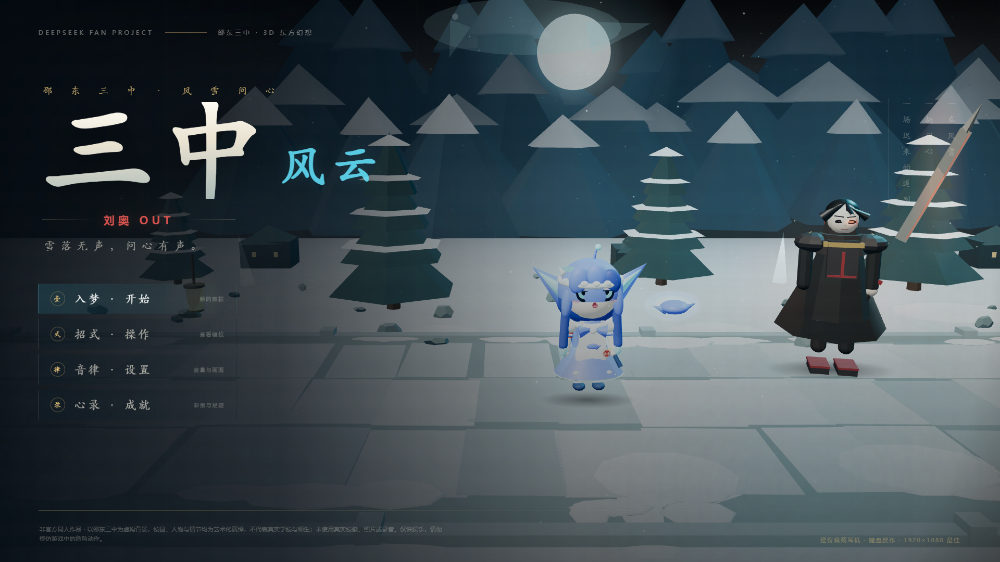

# 三中风云

**刘奥，OUT。**



一款完全运行在浏览器里的 **3D 低多边形水墨武侠动作游戏**。故事以 **邵东市第三中学** 的校园记忆为虚构梦境背景：晚自习后的三中，刘奥的座位空了，刘亚岚的桌上留着一封没有寄出的信。DeepSeek 的 Q 萌鲸形意识接受任务代号 **「深寻」**，进入刘奥用执念拼成的梦境，在雪岭、兰蕙园、逸夫楼与读论天台之间迎战守心人。

> 本作是非官方同人作品，与 DeepSeek 官方、邵东市第三中学及任何真实师生均无隶属关系。校园、人物与情节均为艺术化虚构演绎，不代表真实学校的事实与立场；未使用真实校徽、校园照片、真人照片或真人录音。仅供娱乐，请勿模仿游戏中的危险动作。

---

## 立即游玩

- **在线版：** <https://wuqu02.github.io/shaodong-3-middle-school-game/>
- **本地版：** 下载仓库后直接双击 `index.html`，或运行 `python -m http.server 8080` 后访问 `http://localhost:8080`。
- 建议使用最新版 **Chrome / Edge**，横屏、1920×1080 或更高分辨率，佩戴耳机。
- 游戏使用 WebGL 3D 场景；不支持 WebGL 的设备会自动回退到二维水墨模式。
- 浏览器要求首次点击后才能播放音频；角色语音由系统中文语音合成，设备语音包不同会影响音色。

---

## 操作

| 按键 | 动作 |
| --- | --- |
| `W` `A` `S` `D` | 相对镜头的全向移动 |
| 鼠标右键拖拽 | 第三人称环绕视角 |
| `Space` | 跳跃（可二段跳） |
| `J` / `Z` | 三段连斩 |
| `K` / `X` | 潮涌斩：三道水刃，消耗 Token |
| `Shift` | 闪身：短暂无敌；完美闪身触发 0.2 倍子弹时间 |
| `E` | 卸势：在红光攻击/飞行物命中前弹反，削减对方真气 |
| `R` | 鲸露：消耗一瓶鲸露回复生命 |
| `F` | 处决气竭敌人；与附近的生灵、器物互动 |
| `U` / `V` | 鲸落：心念满时释放全场大招 |
| `T` | 角色成长：分配属性点、参悟武学 |
| `B` | 行囊：装备 / 道具 / 合成 |
| `Tab` | 算力之眼：看见侵蚀、谣言节点与隐匿异常 |
| `G` | AI 娘伙伴：同行、净化与抛弃 |
| `Q` | 三中档案：日历、27 个班级、50 人名册、传言与派系 |
| `M` | 校园区域：教学区 / 宿舍 / 食堂 / 操场 / 图书馆 / 校门 |
| 暂停菜单 | 本地留影：导入本地照片角色（只在浏览器内处理，不上传） |
| `Esc` / `P` | 暂停 / 跳过过场 |
| `空格` / `Enter` / 点击 | 推进对话与过场 |

触屏设备会自动显示虚拟按键。**F 键用于环境互动，E 键仍然是疗伤。**

---

## 故事逻辑

1. **现实：晚自习后的三中。** 刘奥的座位空着。刘亚岚身患重病，桌上留着一封短信：“别为我做傻事。”
2. **禁术：无相之渊。** 刘奥在旧机房发现一台不联网的服务器。它以“逆命”为名，抽取校园里其他学生的「心念」来延续刘亚岚的生机；刘奥明知代价，仍然签下了契约。
3. **梦境：三中被执念改写。** 校门变成山门，兰蕙园变成竹海，逸夫楼变成焚心旧楼，读论天台变成最终战场。每一个心障，都是被抽走心念的人留下的回声。
4. **求援：一枚未寄出的信。** 刘亚岚在昏迷前向 DeepSeek 留下求救灵息：不要让刘奥继续杀人。DeepSeek 的鲸形意识自数据深海醒来，执行任务代号 **「深寻」**——深入刘奥的梦，找到他，带他回来。
5. **对峙：守心人。** 刘奥不是天生的恶人。他为守护最重要的人走错了路，也清楚自己在做什么。刘亚岚在梦境中一次次说“别救我”“请让他停下来”。
6. **终局：让爱不再是牢。** 主角终结逆命之术，把鲸息渡给刘亚岚，保住他的一线生机；刘奥在最后一刻放手。下课铃响起，三中的雪停了，刘亚岚把那封信折成一只纸鲸，肖志雄把一颗松果放在旁边。
7. **主角人名完全自定义。** 「深寻」是任务代号，不是主角名字。主角默认名为 `DeepSeek`，你可以在开局输入自己的名字（最多 10 字），它会进入 HUD、对白、旁白、过场与存档。

---

## 内容

- **约 40–60 分钟**的完整流程：开场动画、三章探索战斗、三道心诀、Boss 三阶段与结局；玩家可自行停留更久。
- **后处理与动画**：UnrealBloom 泛光、冷青国风色彩分级、阈值边缘描边，以及 AnimationMixer 驱动的 Idle/Run/Attack/Dodge/Deflect 状态机。
- **3D 动作战斗底层**：WASD 镜头相对全向移动、鼠标右键环绕镜头、玩家/Boss 架势条（Token 算力）、红光卸势弹反、气竭硬直、靠近按 `F` 处决、完美闪避 0.2 倍时间缩放、0.1 秒卡肉与受击击退。
- **动态 BGM**：探索与战斗无缝切换；卸势、完美闪避、松鼠互动等使用独立程序化音效。
- **3D 场景**：校门、雪地、兰蕙园竹林、逸夫楼旧教室、读论天台。低多边形角色、月光、雪花、雨、余烬与可环绕的动态摄影机。
- **三中校园元素**：邵东三中校门、求真·扬善·尚美校训、星火路与读论山路牌、篮球架、高三教室黑板、课桌、老校铃、校徽与校服臂章。元素均以原创几何体与原创字牌表现，不使用真实校徽图片。
- **可交互环境**：雪兔、狸花猫、锦鲤、竹风铃、纸鹤、香炉、古钟、长明灯、斗笠客谢无咎、兰蕙园木牌、三中老铃，以及会在多章剧情中出现的无敌小松鼠**肖志雄**。靠近后按 `F` 互动；猫会给予 20 秒的“喵力”移速加成，肖志雄则完全不会被剑伤到。
- **角色成长**：击败敌人与精英获得经验，升级提升境界并获得 3 点属性点与 1 点技能点；按 `T` 在「力量 / 敏捷 / 体魄」间自由加点，实时改变剑招伤害、移速与 Token 回复、生命上限。等级、属性、武学与装备进入统一 v2 存档，旧存档会自动迁移。
- **武学与装备**：按 `T` 在卸势流、闪避流、奇术流三条武学路线中参悟心诀；击败敌人会掉落带随机词缀的校园器物（竹枝剑、三角尺、老校铃、教导主任的墨镜等），按 `B` 在行囊中穿戴，词缀实时改变伤害、生命、移速、卸势窗口与冷却。稀有度分为凡品、良品、珍品、传说。
- **攻击即净化**：敌人不再以 HP 结算，而是带「侵蚀度」。攻击削减侵蚀度，归零后敌人恢复清醒 10 秒、道谢并掉落白米饭，随后再次异化；气竭时按 `F` 可直接净化。Boss 的侵蚀度归零即心障消解。
- **物理与精神双重攻击**：异化体会用篮球、粉笔头与扫把造成物理伤害（屏幕红边），也会发出精神尖啸扣除 SAN（雪花噪点、色差偏移）。理智归零会陷入 5 秒幻觉：视野扭曲、操作反向，结束时强制扣血。
- **道具与合成**：汤勺、降噪耳机、加厚课本盾（耐久 3 次）、防刺校服、白米饭、粉笔净化法阵、老式收音机、教导主任的保温杯、午夜剩菜、精神镇静剂。按 `B` 的「合成」页可制作净化之勺、战术通讯器、净化饭团与辟谣取证包。
- **AI 娘伙伴与思维病毒**：12 位 AI 娘全部可同行，最多 3 位同时出战，各带专属被动（侵蚀伤害、精神减伤、SAN 回复、移速、闪身冷却、子弹时间、符咒封印等）。精神攻击有概率感染她们；被感染者会持续吸取玩家理智并传播病毒，可用白米饭/粉笔净化，或抛弃后让她们在后续关卡以「堕落AI」精英怪回归。
- **算力之眼与伪装度**：按 `Tab` 开眼，看见敌人侵蚀度、谣言节点与红眼异常；开眼会持续消耗伪装度。伪装度归零会招来风纪委员围捕。按正常作息上课、休息可以慢慢恢复伪装度；上课时间在校园里动手会额外掉伪装。
- **派系好感加成**：四大 AI 派系与教学 / 体育 / 学业好感达到 10 后解锁被动：深海 +5% 伤害、混沌 -5% 精神伤害、造梦 +3% 移速、幽灵 -5% 闪身冷却；教学 +0.3 SAN/s 与伪装恢复、体育 +10 生命、学业 +10% 经验。
- **谣言与辟谣**：走廊、食堂与表白墙会散播谣言，靠近会持续掉 SAN。带着证据靠近谣言节点按 `F` 可公开辟谣，恢复理智与派系好感；没有证据则会被传得更凶。
- **对话分支与作息**：幸存者与同学会给出选项，不同选择影响奖励、理智与派系好感。8 位幸存者各有专属委托：校训查寝、食堂排队、症状辨认、配平污染样本、递交请假条、辨认画中异常、归还错位档案、追回断线风筝，并各有作息时段；不在自己的时段只能匆匆说两句，需等到对应时段才能完成委托。
- **班级污染生态与行为树**：27 个班级各有 0–100 的污染度与独立行为树（平静 → 流言 → 躁动 → 临界）。行为树会按班风分化：内卷班在刷题与排名间循环，体育班在晨跑与球场冲突间升级，文艺班从排练走向色彩失真，八卦班从匿名墙走向广播异化。每个班还有一条专属事件：倒计时墙、第二名的空位、半场哨声、走廊诗会、机器人夜跑、塔罗翻面、旧曲重弹等 27 条，由本班班主任/班长/学习委员触发；其余情况使用通用班风模板。事件会生成对应班级的异化同学，净化后该班污染下降；每天清晨全年级污染缓慢消退。`Q` 的班级页可看到每个班的污染条、当前行为树状态与最近事件。
- **逐班专属任务链**：每个班级乱到一定程度后，可在 `Q` 的班级卡片底部介入，依次完成 3 步任务链——找班长听一句实话、帮班主任处理心结、把全班带回日常。任务链按班风生成不同文本与效果（内卷、热血、文艺、追星、低语、摸鱼、日常七种倾向），会推进时间、降低该班污染并给经验/派系好感；污染高于 45 时，最后一步会要求先净化该班的异化同学。完成后的班级标记为「已平息」。
- **随堂测验与查寝问答**：教室里的「随堂测验」会抽 3 道校史/学科题，全对获得经验、理智与伪装；答错会掉伪装。宿舍楼的「查寝问答」答对可进安全屋回满状态。两者都受作息限制、每天可做一次。
- **可进入的校园区域**：按 `M` 打开校园图，进入教学区、宿舍区、食堂、操场、特立图书馆与半月广场六个区域。每个区域有独立的污染均值、在场幸存者、作息限制与 4 个行动：认真听课、趴桌补觉、走廊巡视、递交假条；午休、室友夜谈、洗校服、应对查寝；排队打饭、进后厨帮工、拼桌、收剩菜；跑圈、打半场、看台发呆、体育节训练；自习、查旧校史、进闭架书库、整理错题；取信、望风、迎主任巡视、绕双塘散步。行动会推进校园时间、改变理智/伪装/经验/道具与对应班级污染，并可能在区域里触发走廊粉笔字、水房梦话、插队者、跑道影子、还书箱校牌、校门外敲门声等现场事件。
- **校园日历与 27 个班级**：时间线固定为 2025 年 9 月至 2026 年 6 月，按真实高三作息推进；黑板上的高考倒计时每天递减。按 `Q` 查看 27 个班级档案、高2314班 50 人名册、传言、派系、真实校园分区地图、当前作息与幸存者作息表、最近一次年级排名。上课时间在校园里动手会持续降低伪装度。校园里还会随机发生主任巡视、晚自习停电、打饭冲突等事件。
- **校园地标**：雪原校门场景加入半月广场、旗杆、东塘 / 西塘、校友景观石、特立图书馆红色门楼、400 米跑道、收发室、学生公寓（阳台、栏杆、晾晒的校服与空调外机）、三中食堂（大窗、雨棚、烟囱与蒸汽）、逸夫教学楼（三层亮窗、门厅、雨棚与牌匾）以及看台和运动标语；竹海场景加入红柱黄瓦的兰蕙亭；旧楼场景加入科学楼前的奔马雕塑、名人园胸像、「今日我以三中为荣」横幅，以及一间高三教室布景——黑板上方横幅、多媒体屏幕、国旗、蓝窗帘、成摞教辅、蓝白校服学生与讲台老师。
- **区域入口**：在第一章走到学生公寓、食堂、逸夫楼、图书馆或收发室附近按 `F`，会直接进入对应的校园区域；年级布告栏按 `F` 会打开 27 班的班级介入页。第二章与第三章也保留了旧教学楼门厅入口。关卡里的幸存者、同班同学、区域入口和布告栏都有低多边形模型：蓝白校服的同学、发光的区域路牌与贴着通知的木质布告栏。
- **2.5D 照片角色系统**：内置 `PhotoToCharacter`，用角落取样 + 色度键 + Sobel 边缘保护抠除背景，生成透明贴图；在 Three.js 场景中以 Billboard 站立，带呼吸缩放、移动摇摆、脚下阴影。受击时贴图白闪并按像素溶解（Shader）。游戏内可在暂停菜单打开「本地留影 · 照片角色」，选择本地图片、填写名字并选择「学生 / 体育生 / 学霸」后导入当前场景；照片在浏览器内处理，不上传、不写入仓库或存档，刷新页面后消失。控制台也可用 `Photo2D.add(url, { name, faction, x, z, ai })` / `Photo2D.batch([...])` 批量导入，按衣色自动识别「体育生 / 学霸 / 学生」，也可手动指定。识别为体育生的纸片人会追击并碰撞玩家，学霸会保持距离发动精神攻击，学生则在附近游荡；`ai:false` 可关闭行为。
- **有规律的天象**：每个场景约每 22 秒起进入一次天气律动，之后每隔约 72 秒出现一次稀有天象——雪原「鲸群过境」、竹海「萤火成河」、旧楼「彼岸花雨」、天台「血月蚀」。
- **校园精英怪**：眼镜学霸会在竹海投掷粉笔头并预判玩家移动，体育生佐藤在旧楼正面减伤、需要绕背或用卸势打破架势。
- **19 项成就与心录**：入梦、破障、五十连斩、完美闪身、刘奥 OUT、菜就多练、深海拾遗、万物有灵、山中有客、猫奴、深度思考、服务器繁忙、肖志雄、校园行者、班级调解人、全年级放学等。点击标题或暂停菜单的「心录 · 成就」查看。
- **搞怪元素**：气不足时的“服务器繁忙”、静止 20 秒的“正在深度思考”、猫的喵力加持、可以被摸的浮游小鲸、无敌松鼠肖志雄、失败时巨大的「菜」、胜利时的「刘奥 OUT」印章。
- **声画**：纯代码程序化美术与 Web Audio 合成音乐/音效；角色语音使用浏览器 Web Speech API。无外部音频素材。
- **自动存档**：每次破除心障自动留存，死亡后从最近的心灯 checkpoint 重燃。
- **手机触屏**：移动、跳跃、斩击、潮涌、闪身、鲸露、互动与大招虚拟按键。

---

## 原创、隐私与校园说明

这个公开仓库**不包含你文件夹中的真人照片、真人视频或真人录音**。参考素材没有被复制、裁切、转码或上传；刘奥、刘亚岚、DeepSeek 的 Q 萌形象、谢无咎、周娣与所有敌人均为代码绘制的原创风格化演绎。

校园元素参考了公开资料中的校园文化描述：

- 校训“求真、扬善、尚美”
- “苦干、苦教、苦学”的三苦精神
- 读论山、星火路、兰蕙园、逸夫楼、高三教室、运动场等校园意象
- 资料参考：[邵东市第三中学官网](http://www.hnsdsz.cn/)、[维基百科](https://zh.wikipedia.org/wiki/%E9%82%B5%E4%B8%9C%E5%B8%82%E7%AC%AC%E4%B8%89%E4%B8%AD%E5%AD%A6)、[百度百科](https://baike.baidu.com/item/%E9%82%B5%E4%B8%9C%E5%B8%82%E7%AC%AC%E4%B8%89%E4%B8%AD%E5%AD%A6/23790657)

这些仅作为环境氛围与故事背景的灵感来源。本作不代表学校立场，也不声称还原真实校园事件。若你希望制作只供自己观看的本地版本，请自行确认肖像权、隐私权、校名使用权与音乐版权；不要把未经同意的真人素材提交到公开仓库。

---

## 技术结构

```text
.
├─ index.html                # 页面、HUD、对白、过场、成就与触屏 UI
├─ css/style.css             # 标题、HUD、对白、过场、成就等界面样式
├─ js/
│  ├─ utils.js               # 数学、缓动、随机、存储工具
│  ├─ input.js               # 键盘、触屏、手柄输入
│  ├─ audio.js               # Web Audio 音乐/音效与 Web Speech 语音
│  ├─ art.js                 # 二维水墨过场、头像与 WebGL 回退
│  ├─ three-bundle.js        # Three.js r152 + EffectComposer/Bloom（MIT）
│  ├─ threeworld.js          # 3D 低多边形舞台、玩家、Boss、敌人与环境
│  ├─ omens.js               # 天象事件与鲸影/摸鲸投影
│  ├─ interactables3d.js     # 雪兔、猫、锦鲤、校铃等环境互动模型
│  ├─ animation.js           # 玩家 AnimationMixer 状态机（Idle/Run/Attack/Dodge/Deflect）
│  ├─ story.js               # 对白、三中校园叙事、成就、彩蛋与互动数据
│  ├─ campus-data.js         # 27 个班级、高2314班 50 人、12 位 AI 娘、8 位幸存者、传言/事件/配方
│  ├─ campus-systems.js      # 净化战斗、理智、道具、伙伴、伪装、算力之眼、谣言、日历、校园区域、2.5D 照片角色
│  ├─ entities.js            # 玩家、敌人、Boss、投射物、粒子
│  ├─ levels.js              # 章节、遭遇、波次与场景配置
│  └─ game.js                # 主循环、战斗判定、UI、名字、存档与成就
├─ css/campus.css            # 校园异化层界面样式
├─ preview.png
├─ favicon.svg
├─ LICENSE
└─ README.md
```

- 纯原生 JavaScript，无构建步骤。
- Three.js 已本地化到 `js/three-bundle.js`，包含 EffectComposer、RenderPass、UnrealBloomPass 与 GammaCorrection，不需要 CDN。
- 存档使用 `localStorage`，键名：`sanzhongfengyun_save_v1`；成就使用 `sanzhongfengyun_achievements_v1`；设置使用 `sanzhongfengyun_settings_v1`。v2 存档在 `rpg` 字段中统一保存等级、经验、属性、武学、行囊、装备、SAN、伪装度、伙伴、派系好感、道具、校园日历、区域行动记录、班级任务链与班级污染，v1 旧存档读取时自动迁移。
- 2.5D 照片角色为本地运行时生成，照片像素只存在于当前页面与显存中；仓库不包含任何真人照片、视频或录音。
- 新增的高三教室布景参考了真实教室照片里的蓝窗帘、红旗下讲话、多媒体屏幕、成摞教辅与蓝白校服，但学生、老师、桌椅与场景全部由原创几何体重建，没有复制照片像素。
- 若想本地用照片生成 2.5D 角色：在包含照片的目录运行 `python -m http.server 8080`，访问 `http://localhost:8080/game/index.html`，然后在控制台执行 `Photo2D.add('http://localhost:8080/照片文件名.jpg', { name: '角色名', faction: 'athlete', x: 1200, z: 0, ai: true })`。照片只在本地加载，不会提交到仓库或上传到任何服务器。
- 采用 1920×1080 设计坐标；3D 渲染画布与 UI 按窗口等比缩放，高 DPI 设备自动提高渲染分辨率。

---

## 部署到 GitHub Pages

1. 在 GitHub 新建公开仓库。
2. 将本目录全部文件推送到 `main` 分支。
3. **Settings → Pages → Source → Deploy from a branch**。
4. Branch 选择 `main`，目录选择 `/ (root)`，保存。
5. 访问 `https://<用户名>.github.io/<仓库名>/`。

`.nojekyll` 已包含，无需额外工作流。

---

## 致谢

- 校园文化氛围参考：邵东市第三中学公开资料。
- 视觉气质：东方雪岭、竹林、旧楼、天台与水墨留白。
- DeepSeek 的鲸鱼意象作为主角造型与任务「深寻」的视觉母题。
- Three.js（MIT）用于 3D 渲染。

**危险动作请勿模仿。**
